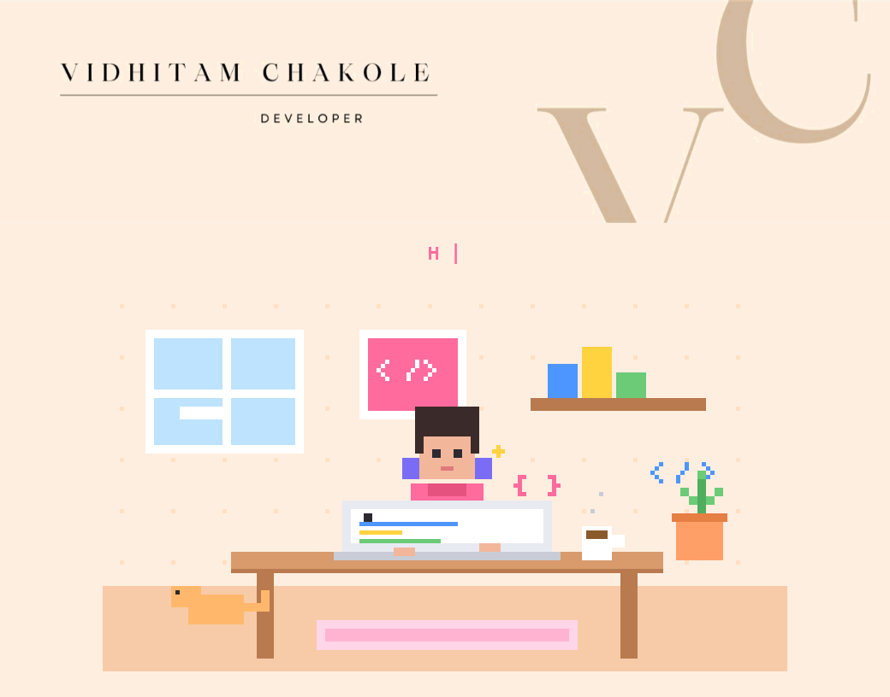
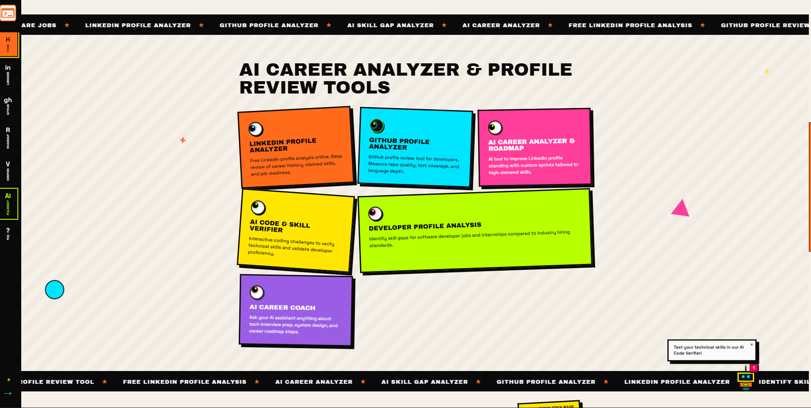
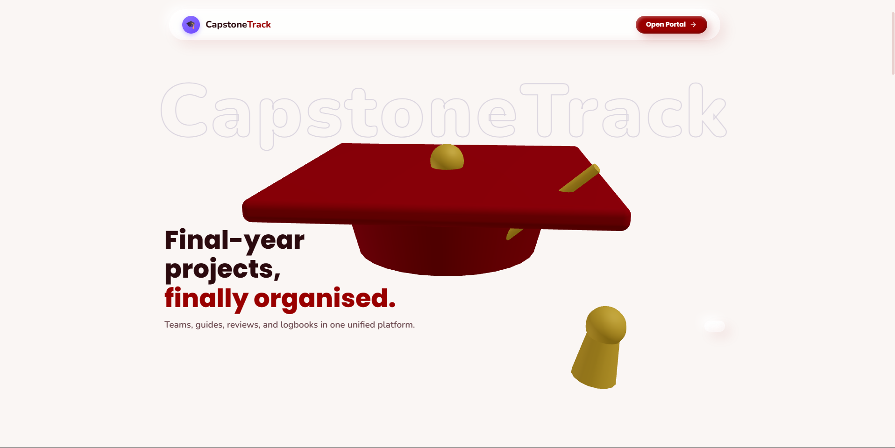
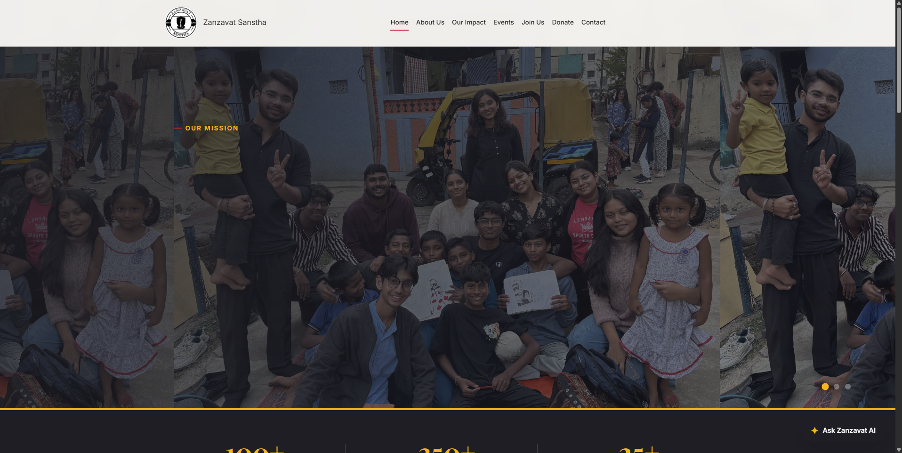

 

[Projects](#projects) · [Tech Stack](#tech-stack) · [Stats](#github-stats) · [Contact](#lets-connect)

---

## ✦ About Me

I'm Vidhitam, and I've never quite fit into just one box. I create, I build, I play, I learn, and somehow all of it connects.

| | |
|---|---|
| ⚡ **The tech side** | B.Tech CSE student building skills in web dev, SQL, Python and C#, and exploring ML, RAG and cloud security |
| ◈ **The people side** | Community and leadership: building a strong network for future projects and innovation |
| ✦ **The creative side** | I write (slowly becoming a book) and make videos and stories with emotion, not just trends |
| ⬡ **What I believe** | Right now, learning matters more to me than earning. Curiosity and experience come first |

- ⚡ **Currently working on:** an Agentic AI project
- ◈ **Learning:** Machine Learning, RAG, cloud security
- ➔ **Open to:** internships, collaborations, and projects where I can build something I couldn't build before

> *I'm not the most experienced person in the room, but I show up with heart, consistency, and the courage to try things most people only talk about.*

---

## ⚡ Tech Stack

  

  
  
  
  
  
  

---

## ⬡ Projects

<!-- ============ PROJECT 1 ============ -->
### 01 ◈ SkillGap AI

  
   
  
  

SkillGap AI reads your LinkedIn and GitHub signals and turns them into practical learning priorities and career next steps. It tells you where you stand in the industry and what to learn next.

**Here's why:**
- ▹ Finds skill gaps and strengths from real repo and profile data
- ▹ Builds a 4-week roadmap from your saved analyses
- ▹ Includes an AI chat assistant for career and learning advice
- ▹ Neo-brutalist UI with cinematic intro and bento grid

**Built with:**

(<a href="#readme-top">back to top</a>)

---

<!-- ============ PROJECT 2 ============ -->
### 02 ◈ CapstoneTrack (IEEE-Nexus)

  
   
  
  

A modern Capstone Project and Internship Management ERP that replaces messy WhatsApp groups and manual spreadsheets with deterministic guide allocation and conflict-free review scheduling.

**Here's why:**
- ▹ Team formation with unique join codes and strict rules (2-4 members, one lead)
- ▹ Guide allocation engine with load balancing based on ranked faculty preferences
- ▹ Zero-conflict presentation scheduling
- ▹ 12-week progress heatmap for every team

**Built with:**

(<a href="#readme-top">back to top</a>)

---

<!-- ============ PROJECT 3 ============ -->
### 03 ◈ Zanzavat Sanstha Website

  
   
  
  

The official web platform for Zanzavat Bahuudeshiya Shaikshanik Sanstha, a registered NGO established in 1995 and working on child welfare, health services and rural development in Nagpur.

**Here's why:**
- ▹ Gives a real organization a real home on the web
- ▹ AI chat powered by the Groq API
- ▹ Join, donate and contact flows with email support
- ▹ Supabase database with a local JSON/CSV fallback

**Built with:**

(<a href="#readme-top">back to top</a>)

---

## ◈ GitHub Stats

  
  

  

  

---

## ➔ Let's Connect

  
  
  <!-- Add later: Instagram, X, Portfolio -->
  

Still learning. Still experimenting. Still figuring things out. And perhaps that's the point. ✦

